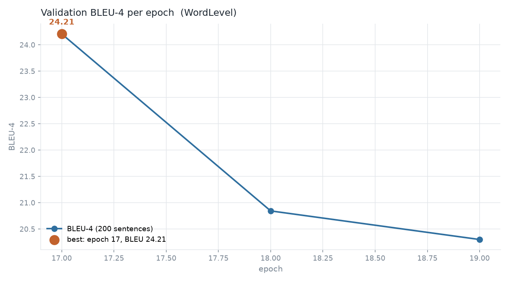
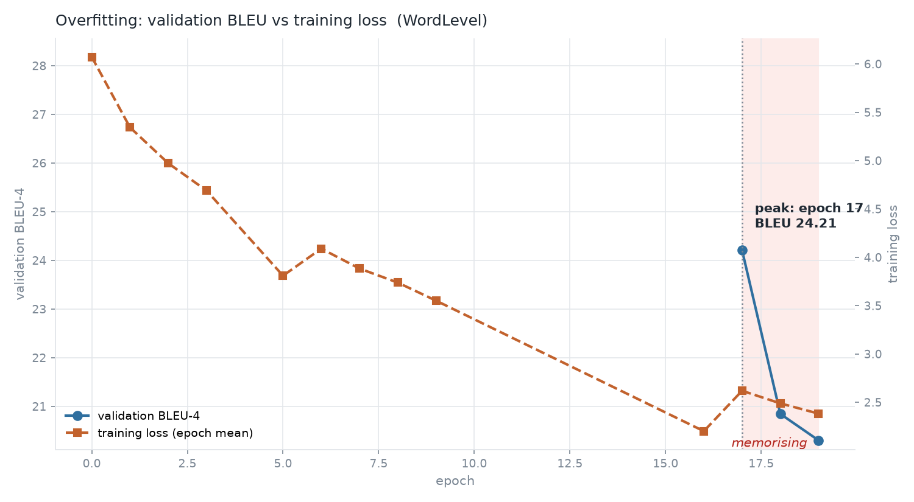
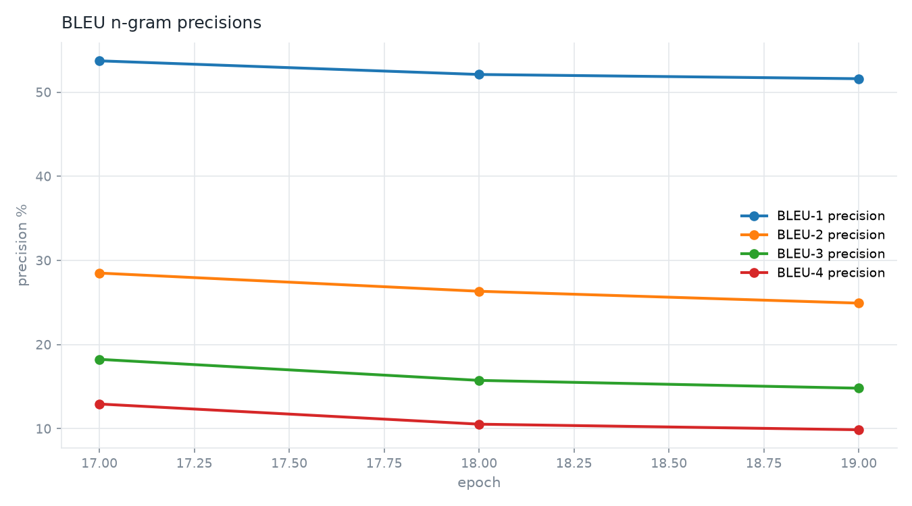
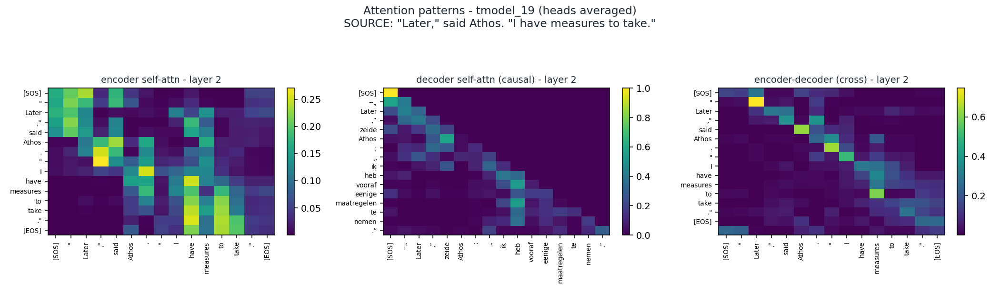
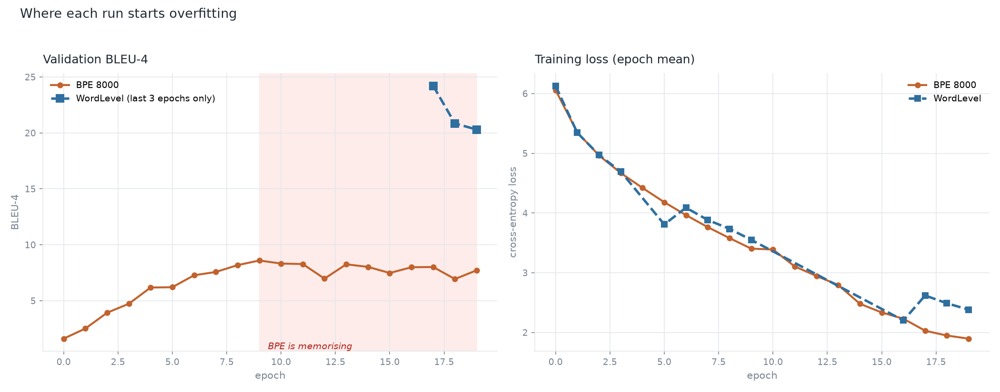
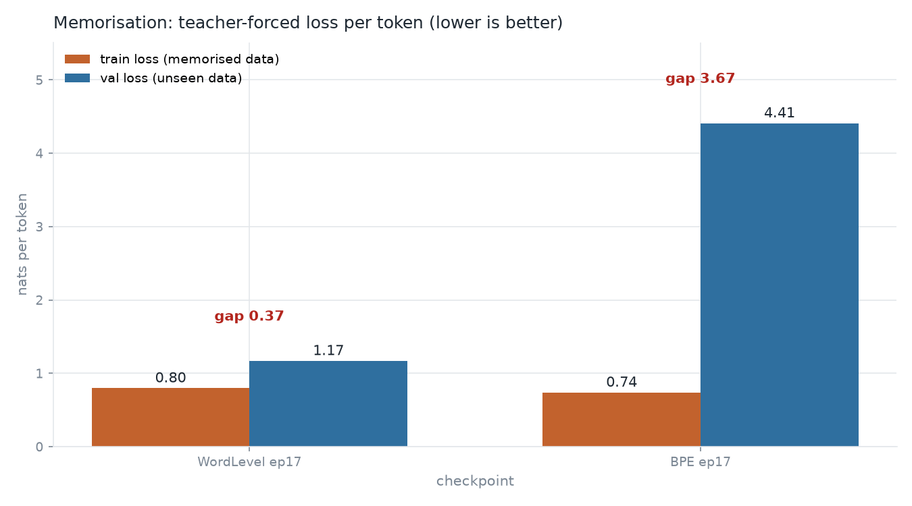

# Transformer from scratch — English → Dutch

[](https://colab.research.google.com/github/abhijitdalal26/transformers-from-scratch/blob/main/pytorch-transformer/colab_transformer_training.ipynb)

The point of the project was to **learn the transformer architecture** by
implementing every part of it and watching what it actually does when you
train it. The architecture lives in
[`pytorch-transformer/model.py`](pytorch-transformer/model.py); the dataset is
small (38,652 sentence pairs), the model is small (73.1M parameters), and the
hardware was a single Colab T4 — so this is not a state-of-the-art translation
system, just a complete, instrumented implementation of the paper.

**The graphs** below are the quickest way to see what actually happened.

---

## Repository layout

```
neural-network-projects/
├── pytorch-transformer/        ← the project
│   ├── model.py               the transformer
│   ├── dataset.py             tokenisation + batching
│   ├── config.py              hyperparameters + checkpoint resolution
│   ├── train.py               training loop + validation
│   ├── translate.py           inference
│   ├── requirements.txt
│   ├── colab_transformer_training.ipynb
│   ├── results/               the tracked record: reports, metrics, graphs
│   ├── pdf/                   "Attention Is All You Need" + the paper diagrams
│   ├── model/                 tmodel_17.pt + tokenizers      (local only)
│   ├── drive_bpe/             BPE weights + per-epoch CSV   (local only)
│   ├── graphs/                generated plots                (local only)
│   ├── tools/                 analysis and plotting scripts  (local only)
│   └── runs/                  TensorBoard event files        (local only)
├── karpathy/                  BPE from scratch, makemore
├── LLaMA/                     LLaMA 1/2/3 papers
└── imgs/                      figures for the foundation notebooks
```

**`pytorch-transformer/` is the project.** Everything tracked in git that
matters lives in `results/`.

**`model/`, `drive_bpe/`, `graphs/` and `tools/` are local-only.** They are
not pushed to GitHub: `model/` holds an 838 MB checkpoint, and the other
three are working copies of things that are either regenerable
(`graphs/`, via `tools/make_graphs.py`) or already captured in the tracked
results (`drive_bpe/`'s metrics CSV, which is also saved under
`results/bpe/`). They stay on disk so the project still runs end to end.

---

## The Transformer model

Five files make up the whole project.

| File | What it holds |
|---|---|
| [`model.py`](pytorch-transformer/model.py) | **The transformer.** `PositionalEncoding` (sinusoidal), `InputEmbeddings`, `MultiHeadAttentionBlock`, `FeedForwardBlock`, `ResidualConnection`, `LayerNormalization`, `EncoderBlock` / `DecoderBlock`, `Encoder`, `Decoder`, `ProjectionLayer`, and the `Transformer` class that wires them together. Causal masking for the decoder, padding masks for the encoder, everything from the paper, no library. |
| [`dataset.py`](pytorch-transformer/dataset.py) | `BilingualDataset` — tokenises the parallel corpus, adds `[SOS]`/`[EOS]`/`[PAD]`, builds the causal and padding masks, truncates over-long sentences, and yields batches. Plus `causal_mask(size)`. |
| [`config.py`](pytorch-transformer/config.py) | Every hyperparameter in one place (d_model, layers, heads, d_ff, dropout, seq_len, LR, batch size, label smoothing, epochs) and the checkpoint-resolution logic: where weights live, which tokenizer to load, which epoch to use. Every other file anchors its paths here, so the model folder can be moved without touching anything else. |
| [`train.py`](pytorch-transformer/train.py) | The training loop, the validation pass, greedy decoding, and the metrics. Includes a hand-written `corpus_bleu` (torchmetrics' BLEU returns 0.0 in this environment) and a per-epoch metrics CSV. |
| [`translate.py`](pytorch-transformer/translate.py) | Single-sentence inference. Encodes once, then decodes greedily, caching the 838 MB checkpoint so repeated calls are fast. Takes a raw sentence or a dataset index, and `--checkpoint N` to pick an epoch. |

---

## The result

| | |
|---|---|
| **Model** | `pytorch-transformer/model/tmodel_17.pt` (epoch 17, global step 78,282) |
| **Architecture** | 6 encoder + 6 decoder layers, d_model 512, 8 heads, d_ff 2048, dropout 0.1, sinusoidal positional encoding |
| **Parameters** | 73,138,357 |
| **Tokenizer** | WordLevel, 17,396 English / 19,637 Dutch words, `[UNK] [PAD] [SOS] [EOS]` |
| **Data** | `Helsinki-NLP/opus_books`, 38,652 pairs → 34,786 train / 3,866 val (seeded 90/10 split, seed 42) |
| **Training** | 20 epochs, 4,349 steps/epoch, 86,980 steps, batch 8, Adam (eps 1e-9), constant LR 1e-4, label smoothing 0.1, Colab T4 |
| **Scored on** | the first 200 held-out validation sentences, greedy decoding |

| Metric | Value |
|---|---|
| BLEU-4 (cased) | **24.2076** |
| BLEU-4 (case-blind) | **24.4271** |
| Precision p1 / p2 / p3 / p4 | 0.5372 / 0.2850 / 0.1824 / 0.1294 |
| Brevity penalty | 0.9873 |
| CER / WER | 0.5686 / 0.9196 |
| Empty predictions | 0 / 200 |

### What the models actually say

Both models, same sentences, greedy decoding. The first four sentences are in
neither the training nor the validation split; the last two are from the
held-out validation split.

| English | WordLevel (epoch 17) | BPE (epoch 9) | Reference Dutch |
|---|---|---|---|
| Where is the station? | Waar is het station ? | waar is het station? | Waar is het station? |
| I have two brothers and one sister. | Ik heb twee broeders en een zuster . | ik heb twee broer en een zuster. | Ik heb twee broers en een zuster. |
| We were very happy yesterday. | Wij waren gisteren al zeer gelukkig . | het was gisteren gelukkig. | Wij waren gisteren zeer gelukkig. |
| The man who came yesterday is my friend. | De man , die gisteren is , is reeds mijn vriend ! | de man die gisteren is aangekomen. | De man die gisteren kwam is mijn vriend. |
| But it was too late. | Maar het was te laat . | doch het was te laat. | Doch het was te laat. |
| Joe took a pin out of his lapel and began to assist in exercising the prisoner. | Joe nam een speld uit de panden van zijn buisje en begon de behulpzame hand te bieden om het diertje te geven . | joe nam een spekpeltje en begon in de gevangenis te bevelen. | Joe nam een speld uit de panden van zijn buisje en begon de behulpzame hand te bieden om het diertje mores te leeren. |

26 more sentences across four checkpoints are in
[`results/comparison/bpe_sweep/inference_showcase.md`](pytorch-transformer/results/comparison/bpe_sweep/inference_showcase.md).

---

## Results and artefacts

### The overfitting curve

Validation BLEU-4 rose for 17 epochs and then fell off a cliff, while the
training loss kept going down. That gap between "it fits the training data
better and better" and "it is getting worse at the real task" is the single
most useful thing this project produced.

| Epoch | BLEU-4 | CER | WER | train loss |
|---|---|---|---|---|
| **17** | **24.21** | 0.569 | 0.920 | ~2.5, falling |
| 18 | 20.85 | 0.580 | 0.921 | falling |
| 19 | 20.30 | 0.591 | 0.937 | 1.83 |

BLEU fell 3.91 points (16% relative) over the last two epochs. The precisions
show *how* it degraded: p1 only dropped 2.1 points (0.5372 → 0.5160) while p4
dropped 3.1 points, 24% relative (0.1294 → 0.0988). The model kept choosing
the right *words* and lost the *ordering*.

The lesson: the last two epochs of compute were wasted, and a 34,786-pair
dataset with a 73M-parameter model is already past the point where more
training helps.

### The BPE run, and what it taught

I re-ran the whole experiment with a BPE tokenizer (8,000 merge-based
subwords, 56.40M parameters) to test the hypothesis that the WordLevel
tokenizer was the ceiling on quality. **That hypothesis was wrong, and the
experiment is more interesting than the original project.**

| | WordLevel ep17 | BPE ep9 (its own best) | BPE ep17 | BPE ep19 |
|---|---|---|---|---|
| BLEU-4 cased | **24.2076** | 8.5951 | 8.0134 | 7.7222 |
| BLEU-4 case-blind | **24.4271** | 11.5511 | 10.9415 | 10.1922 |
| generalisation gap (nats/token) | **0.474** | 1.784 | 3.779 | 4.028 |
| source dependence | **81.2%** | 43.8% | 42.0% | 38.5% |

Two independent measurements show the BPE model was **memorising**, not
translating:

1. **Generalisation gap.** Teacher-forced loss on the training set versus on
   unseen data. WordLevel's gap is 0.474 nats/token. BPE's gap is already
   1.784 nats/token at its *best* checkpoint — 3.8× worse — and grows to
   4.028 (8.5×) by epoch 19 while its training loss keeps falling.
2. **Source dependence.** Feed the encoder a shuffled or blanked-out source
   and see how much of the score survives. WordLevel loses 81.2% of its
   performance, so it is genuinely reading the English sentence. BPE starts at
   43.8% and *falls monotonically* to 38.5% as it trains. The model was
   progressively **stopping reading its input** and emitting a generic
   average Dutch sentence instead.

The tokenizer itself did its job perfectly: unknown-word rate went from
1.27% to 0.00% on the source and 1.60% to 0.00% on the reference, and the
vocabulary shrank from 37,033 entries to 16,000. And the comparison was
actually *generous* to BPE, because its tokenizers were built from the whole
corpus including the validation split (`train.py:333-334`) while the
WordLevel tokenizer was built from the training split only.

The mechanism is plain: BPE splits a word into ~1.3 pieces, so it gets
232,016 target tokens per epoch instead of WordLevel's 205,452 — 26,564 extra
free supervision targets per epoch on a corpus of only 34,786 pairs. More
targets to memorise, and a vocabulary that can represent any of them.

**What I take from it:** BPE is not worse, it is *underfed*. It won on every
axis that matters for translation (no unknowns, shorter sequences, subword
morphology) and still lost, purely because there was not enough data to
learn it. The moment this same BPE model is trained on a million-plus pairs
instead of 35 thousand, with a learning-rate schedule and early stopping, it
is the one that should win — the subword vocabulary generalises to unseen
words, and the WordLevel vocabulary structurally cannot. **The tokenizer was
never the bottleneck. The dataset size was.**

### The graphs

Generated by `tools/make_graphs.py` and `tools/make_comparison_graphs.py`.
The six that matter are here; the rest live in the local-only `graphs/`
folder and can be regenerated at any time.

#### Validation BLEU-4 per epoch



The curve climbs for 17 epochs and then turns over, so `tmodel_17.pt` is the
checkpoint to keep. This is the only curve that decides anything — the
training loss never shows this turning point.

#### Overfitting



Training loss and validation BLEU on one axis. The lines cross at the peak:
after that the model keeps fitting the training data better while getting
worse at the real task. This is what overfitting looks like from outside.

#### BLEU precisions



The four precisions for the last three epochs. Short n-grams barely move
while long ones collapse, so the model kept picking the right words and lost
the word order. It failed on structure, not vocabulary.

#### Attention



Heatmaps from the trained model. Self-attention shows what each head
latches onto inside a sentence; cross-attention shows the decoder lining up
an English word with its Dutch counterpart. Reading these is the fastest way
to see that the model learned structure rather than a lookup table.

#### Where each run starts overfitting



Both runs on one axis. The WordLevel run turns at epoch 18; the BPE run was
already turning at its own peak, epoch 9. BPE memorised eight epochs earlier,
which is a large part of why its best score is so much lower.

#### Memorisation evidence



Teacher-forced loss per token on the training data versus on unseen data,
for the two best checkpoints. The gap *is* the memorisation: tiny for
WordLevel, enormous for BPE. This is the single measurement that settled the
question of why BPE lost.

---

## Running it

```bash
# 1. environment
python -m venv venv
venv\Scripts\activate            # venv/bin/activate on macOS/Linux
pip install -r pytorch-transformer\requirements.txt

# 2. translate a sentence with the trained checkpoint
cd pytorch-transformer
python translate.py "But it was too late."
python translate.py --checkpoint 17 "The cat sleeps on the table."

# 3. train from scratch
#    NUM_EPOCHS defaults to 1 so a stray run cannot fill the disk.
#    Every knob below is an environment variable; see config.py.
set NUM_EPOCHS=20 & set EARLY_STOP_PATIENCE=2 & python train.py
```

`config.py` is the single source of truth for the run, and every value can be
overridden by an environment variable:

| Variable | Default | What it does |
|---|---|---|
| `NUM_EPOCHS` | `1` | how many epochs to train |
| `LR` | `1e-4` | learning rate |
| `LR_SCHEDULE` | `none` | `none`, `noam` (the paper's schedule), `cosine`, or `linear_decay` |
| `EARLY_STOP_PATIENCE` | `0` | stop after N epochs with no validation BLEU improvement (`0` = never) |
| `KEEP_BEST` | `1` | also save the best checkpoint as `tmodel_best.pt` |
| `SAVE_WEIGHTS_ONLY` | `0` | `1` drops the Adam moments: ~294 MB per checkpoint instead of ~838 MB |
| `VAL_SAMPLES` | `200` | how many validation sentences to decode and score each epoch |
| `DROPOUT`, `LABEL_SMOOTHING` | `0.1`, `0.1` | regularisation |

Per-epoch metrics are appended to `results/wordlevel/training_metrics.csv`,
so the peak epoch can always be identified after the fact.

The dataset (`Helsinki-NLP/opus_books`) is downloaded from Hugging Face on
first run. `colab_transformer_training.ipynb` is the same run on a Colab T4
with TensorBoard attached.

To reproduce the analysis in `results/`, the local `tools/` directory has one
script per question: scoring, the checkpoint sweep, the generalisation-gap
measurement, the source ablation, the side-by-side translations, the plots
and the attention heatmaps.

---

## Where it goes next

The architecture is learned and it is solid. What is missing is scale, and
scale is a data problem, not an architecture problem:

1. **More data.** 34,786 pairs is a demonstration set, not a training set. A
   million-plus pairs of `opus_books` or `NLLB` would be the single biggest
   lever, and it is the lever that would flip the BPE result.
2. **Turn on the learning-rate schedule.** The NoAM schedule and a cosine
   decay are already implemented in `config.py` (`LR_SCHEDULE=noam` or
   `cosine`), but the checkpoint on disk was trained with a constant LR, so
   they were never switched on. A warmup-plus-decay schedule is worth a
   couple of BLEU on its own.
3. **Turn on early stopping.** `EARLY_STOP_PATIENCE=2` would have stopped the
   run at epoch 18 instead of 19, and it keeps the best checkpoint rather
   than the last one. The run went 3 epochs past its own peak and threw away
   16% of the score. Stopping at the peak is free.
4. **Beam search with length normalisation.** Greedy decoding was used
   throughout for simplicity; beam search is a few points of BLEU for very
   little work.
5. **Fix the tokenizer leakage** in `train.py:333-334` so the tokenizers are
   built from the training split only.
6. **Then move to a decoder-only model** — the `makemore` transformer in
   `karpathy/`, and eventually a small LLaMA.

---

## Credits

This project exists because of other people's teaching.

- **Umar Jamil** — the course that taught me the transformer architecture from
  scratch, and the code this project started from.
  [Course video](https://youtu.be/ISNdQcPhsts?si=f6XcgU_cMpWwCLoO) ·
  [original repository](https://github.com/hkproj/pytorch-transformer)
- **Andrej Karpathy** — `minbpe/`, the BPE tokenizer written from scratch in
  stages, which is where I went to understand how subword tokenization
  actually works.
- **Vaswani et al. (2017)** — "Attention Is All You Need", in
  `pytorch-transformer/pdf/`.
