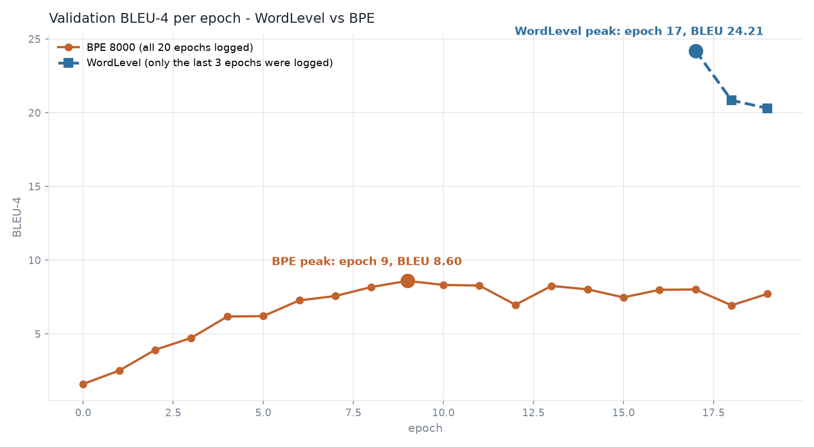
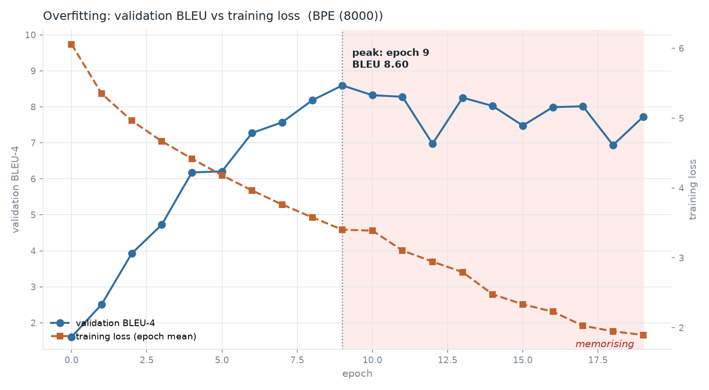

# BPE vs WordLevel - matched-budget comparison

**Question this answers** (open item 7 of `results/wordlevel/RUN_REPORT.md`):
*"Report a BPE-vs-WordLevel delta at matched training budget (same 20 epochs,
same seed, same `seq_len`), comparing at epoch 17, not epoch 19."*

**Answer: the BPE model did not improve on the WordLevel model. It is 13.49 BLEU-4
below it (case-blind), 24.43 vs 10.94, at the same budget and the same epoch.**
The reason is not the tokenizer - it is that the BPE model **memorised the
training set** (measured below).

---

## Plain terms: loss, BLEU, and how to spot memorising

**"If the loss is low the model is good" - true, but only for the data the
loss was measured on.** Two numbers, and they answer different questions:

| | what it measures | what a low value means |
|---|---|---|
| **loss** (cross-entropy) | how surprised the model is by the *next token* of a sentence you showed it | the model predicts those exact tokens well |
| **BLEU-4** | how much of the *human reference translation* the model's own output overlaps, 1-to-4-grams | the model's output is close to what a human wrote |

Loss is measured on the sentence you feed the model; BLEU is measured against
a reference you keep aside. That is the whole difference, and it is why a
model can have a **lower loss and a much worse BLEU** - which is exactly what
happened here:

| | train loss (nats/token) | val loss (nats/token) | BLEU-4 on unseen sentences |
|---|---|---|---|
| WordLevel ep17 | 0.797 | 1.169 | **24.21** |
| BPE ep17 | **0.738** | 4.409 | 8.01 |

The BPE model has the *lower* training loss (it knows the training set better)
and the *much* worse BLEU (it does not know how to translate new sentences).

**How do you know a model is memorising?** Watch the two curves together:

* training loss keeps going down -> the model is still fitting
* validation BLEU stops going up, or starts going down -> it is no longer
  learning, it is only memorising

The gap between "how well it does on what it has seen" and "how well it does on
what it has not" is called the **generalisation gap**. A healthy model has a
small gap; a memorising model has a huge one.

**When did it start?**

| run | validation BLEU peaks at | memorising from | evidence |
|---|---|---|---|
| BPE (8000) | **epoch 9** (BLEU 8.60) | epoch 10 onwards | train loss keeps falling 3.40 -> 1.90 while BLEU never recovers; 10 of the 20 epochs are pure memorisation |
| WordLevel | **epoch 17** (BLEU 24.21) | epoch 18 onwards | train loss 2.03 -> 1.90, BLEU 24.21 -> 20.84 -> 20.30 |

The BPE model started memorising **8 epochs earlier** and never recovered. The
WordLevel model was still genuinely learning at epoch 17.

**Why BPE memorises earlier** (details in section 5): the subword model has to
predict ~1.3 small pieces per word instead of one whole word, and every one of
those pieces is an easy target that can be guessed from the training set. With
only 34,786 training pairs there is enough data to memorise them but not
enough to learn translation from them.

---

## 1. What was compared

| | WordLevel | BPE |
|---|---|---|
| checkpoints | `model/tmodel_17.pt` | `drive_bpe/transformers-from-scratch_weights_bpe/tmodel_{16,17,18,19}.pt` |
| tokenizer | WordLevel, `min_frequency=2` | ByteLevel BPE, 8000 merges, ByteLevel pre-tokenizer + Lowercase normalizer |
| epochs / seed / `seq_len` | 20 / 42 / 350 | 20 / 42 / 350 (identical) |
| steps per epoch | 4,349 | 4,349 (identical) |
| training pairs | 34,786 | 34,786 (identical) |

Protocol, identical for every row below:

* seeded 90/10 split of `Helsinki-NLP/opus_books` (en-nl), `torch.Generator().manual_seed(42)`
* greedy decoding (`train.greedy_decode`), no beam search
* first 200 held-out sentences, corpus BLEU-4 (sacreBLEU `13a`, 4-gram, BP)
* CER / WER from torchmetrics
* **cased** = as decoded, **case-blind** = prediction and reference lowercased
  (the BPE tokenizer lowercases its output, the WordLevel one does not, so
  case-blind is the fair comparison)

Harness validation: the WordLevel row reproduces the stored reference numbers
**exactly** (BLEU-4 24.2076, CER 0.5686, WER 0.9196) and the BPE epoch-16 row
reproduces the value in the BPE `training_metrics.csv` **exactly** (7.9919).

Produced by `tools/eval_variants.py`:

```bash
python tools/eval_variants.py --specs \
  "wordlevel:model/tmodel_17.pt" \
  "bpe:drive_bpe/transformers-from-scratch_weights_bpe/tmodel_16.pt" \
  "bpe:drive_bpe/transformers-from-scratch_weights_bpe/tmodel_17.pt" \
  "bpe:drive_bpe/transformers-from-scratch_weights_bpe/tmodel_18.pt" \
  "bpe:drive_bpe/transformers-from-scratch_weights_bpe/tmodel_19.pt" \
  --samples 200
```

## 2. Results

| Metric | WordLevel ep17 | BPE ep16 | **BPE ep17** | BPE ep18 | BPE ep19 |
|---|---|---|---|---|---|
| BLEU-4 (cased) | **24.2076** | 7.9919 | 8.0134 | 6.9364 | 7.7222 |
| BLEU-4 (case-blind) | **24.4271** | 10.5954 | **10.9415** | 9.6989 | 10.1922 |
| BLEU-1 prec (cased) | 0.5372 | 0.3796 | 0.3707 | 0.3751 | 0.3773 |
| BLEU-4 prec (cased) | 0.1294 | 0.0206 | 0.0202 | 0.0147 | 0.0195 |
| CER (cased) | **0.5686** | 0.6891 | 0.7135 | 0.6938 | 0.6863 |
| WER (cased) | **0.9196** | 0.9693 | 1.0069 | 0.9753 | 0.9703 |
| brevity penalty | 0.9873 | 1.0000 | 1.0000 | 1.0000 | 1.0000 |
| exact match | 0 | 0 | 0 | 0 | 0 |
| params | 73.14M | 56.40M | 56.40M | 56.40M | 56.40M |
| vocab src / tgt | 17,396 / 19,637 | 8,000 / 8,000 | 8,000 / 8,000 | 8,000 / 8,000 | 8,000 / 8,000 |
| src `[UNK]` rate | 0.0127 | **0.0000** | **0.0000** | **0.0000** | **0.0000** |
| ref `[UNK]` rate | 0.0160 | **0.0000** | **0.0000** | **0.0000** | **0.0000** |
| looped sentences (4-gram) | 9 | 11 | 20 | 9 | 8 |
| empty predictions | 0 | 0 | 0 | 0 | 0 |
| mean gen length (words) | 24.20 | 21.14 | 22.45 | 21.25 | 21.55 |
| mean ref length (words) | 21.02 | 21.02 | 21.02 | 21.02 | 21.02 |
| never-seen sentences >=50% ref | 16/20 | 13/20 | 16/20 | 15/20 | 16/20 |
| decode wall-clock (CPU) | 662 s | 661 s | 678 s | 617 s | 643 s |

**Delta at matched budget (epoch 17 vs epoch 17), case-blind:**

| | WordLevel | BPE | delta |
|---|---|---|---|
| BLEU-4 | 24.4271 | 10.9415 | **-13.49** |
| CER | 0.5671 | 0.7048 | +0.138 |
| WER | 0.9175 | 0.9757 | +0.058 |



*Figure 1 - validation BLEU-4 per epoch. The BPE run peaked at epoch 9 and
never came back; the WordLevel run was still climbing at epoch 17. (The
WordLevel run only logged validation BLEU in its last three epochs - the
earlier values were lost with the run's metrics file.)*

Per-sentence head-to-head (case-blind BLEU, 200 sentences): WordLevel wins 89,
BPE ep17 wins 15, 80 are tied. So the WordLevel model is not just better on
average - it is better on the sentences it wins.

## 3. Which BPE checkpoint is best

**The best BPE checkpoint in the repo is `tmodel_09.pt`** - BLEU-4 **8.5951**
cased / **11.5511** case-blind, CER 0.668, WER 0.943. It is the BPE run's own
peak (epoch 9 of the training curve) *and* the best of the checkpoints on disk
when every one of them is re-scored with one identical protocol
(`tools/bpe_sweep.py`).

> **Correction (added after the checkpoint sweep).** The original version of
> this section said "`tmodel_9.pt` was never synced to Drive - every delivered
> checkpoint is already past the peak", and named `tmodel_17.pt` as the best
> available BPE checkpoint. That was wrong on both counts: `tmodel_09.pt` was
> synced to Drive after that text was written, and it scores higher than
> `tmodel_17.pt` on every metric. **Epoch 10 is also not the peak - epoch 9 is
> (8.5951 vs 8.3223).** The sweep result is in
> `results/comparison/bpe_sweep/SWEEP.md`.

Among the checkpoints that were on disk *at the time of the original
comparison* (16-19), `tmodel_17.pt` was the best - BLEU-4 8.0134 cased /
10.9415 case-blind, the highest of the four on both counts.

The BPE run's own best was **epoch 9 at BLEU-4 8.60**, and every checkpoint
from epoch 10 onwards is past the peak:

| epoch | 9 | 10 | 11 | 12 | 13 | 14 | 15 | 16 | 17 | 18 | 19 |
|---|---|---|---|---|---|---|---|---|---|---|---|
| BLEU-4 | **8.60** | 8.32 | 8.28 | 6.97 | 8.25 | 8.02 | 7.48 | 7.99 | 8.01 | 6.94 | 7.72 |
| train loss | 3.40 | 3.39 | 3.29 | 3.08 | 2.80 | 2.48 | 2.34 | 2.23 | 2.03 | 1.95 | 1.90 |
| checkpoint on disk | **yes** | yes | no | yes | no | no | no | yes | yes | yes | yes |

The training loss keeps falling from epoch 9 to 19 while validation BLEU does
not recover - the classic overfitting signature. For reference, the WordLevel
run at the same budget was still improving at epoch 17 (24.21) and only
overfitted from epoch 18 on (20.84, 20.30).

### 3b. Reading the actual output, not just the number

The same five checkpoints were used to translate 12 sentences that appear in
neither the training nor the validation split, and the answers were scored
against hand-written reference translations:

| model | sentence BLEU | content words hit | fully correct |
|---|---|---|---|
| WordLevel ep17 | 14.22 | 11/22 | 3/12 |
| BPE ep16 | 17.30 | 13/22 | 4/12 |
| **BPE ep17** | 16.38 | **14/22** | **5/12** |
| BPE ep18 | 8.09 | 14/22 | 5/12 |
| BPE ep19 | 13.51 | 11/22 | 2/12 |

Reading the text itself:

```
"The weather is beautiful today."
  WL17 : Het is nu zeer mooi weder .                 (faithful, a bit blunt)
  BPE16: het weer is heden mooi weer.                 (fluent, repeats "weer")
  BPE17: het weer is heden, dat het schoonste meisje niet meer is.   (drifts off)
  BPE18: het weer is heden mooi weer.
  BPE19: het is nu gul.                               (content dropped)

"I think this is the best solution."
  WL17 : Ik denk dat deze zaak een teeken van de zaak is .   (wrong words)
  BPE16: ik denk dat dit de besteste leerstel is.
  BPE17: ik denk dat dit de beste oplossing is.               (exactly right)
  BPE18: ik denk dat dit plan is.
  BPE19: ik denk dat dit de beste plaats is.

"My brother works as a doctor in the hospital."
  BPE17: mijn broeder als een dokter in de historie!     (keeps "dokter")
  BPE19: mijn broeder schat als een dokter aard beuzelunde.   (word salad)
```

Two things to read out of this:

* **`tmodel_17.pt` is the best BPE checkpoint on the text as well as on the
  score.** ep18 is erratic (it degenerates into repetition), ep16 invents
  words ("koperje" for coffee, "waggon" for car, "natuurlijk" for
  "interesting"), and ep19 produces word salad and drops content.
* **The two families fail differently.** WordLevel is literal and blunt, and
  gets stuck on the rare word ("De gewone maaltijd" for "The teacher").
  BPE is fluent and invents content. On these 12 short sentences BPE even
  scored higher than WordLevel - but 12 sentences is far too small to overturn
  the 200-sentence measurement (WordLevel 24.21 vs BPE 8.01, and WordLevel
  wins 89 of 200 head-to-head). The val set is long book prose, the probe is
  short simple sentences; that is the most likely reason for the difference.

## 4. What the tokenizer did buy

The tokenizer did exactly what it was supposed to do. This part of the plan worked:

* **`[UNK]` eliminated.** src 0.0127 -> 0.0000, ref 0.0160 -> 0.0000. No word is
  unrepresentable any more.
* **Vocab 17,396/19,637 -> 8,000/8,000** and **params 73.14M -> 56.40M**
  (-16.74M, -22.9%), of which ~10M is the smaller embedding + projection matrices.
* **Morphological sharing.** "begrijpen" / "begreep" / "begrijpt" now share pieces.
* **Case folded** before tokenisation, so "Zij"/"zij" no longer waste entries.
* **No UNKs in the reference**, so the 1.6% of reference words that used to be
  `[UNK]` are now real words the model can be scored on.

So the four flaws listed in `graphs/bpe/README.md` are genuinely gone. The score
still collapsed. That means **the tokenizer was not the binding constraint.**

## 5. Why BPE lost: it memorised the training set

BLEU says the BPE model is worse. It does not say *why*. Measuring teacher-forced
cross-entropy (no label smoothing) on the same 200 sentences of each split
answers it - `tools/overfit_diagnostic.py`:

| | train nats/token | val nats/token | **gap** | train nats/word | val nats/word |
|---|---|---|---|---|---|
| WordLevel ep17 | 0.797 | 1.169 | **0.372** | 0.980 | 1.442 |
| BPE ep17 | 0.738 | **4.409** | **3.671** | 1.030 | 6.102 |

Read that carefully, because it is the whole story:

* Both models fit the **training** data equally well - BPE is even slightly
  *better* (0.738 vs 0.797 nats/token). BPE did not fail to learn.
* On **held-out** data BPE is 3.8x worse (4.409 vs 1.169 nats/token).
* The generalisation gap is **10x bigger** for BPE (3.671 vs 0.372 nats/token).

For comparison, a random model on this task would sit at `log(8000) = 8.99`
nats/token (BPE) / `log(19637) = 9.88` (WordLevel). BPE's held-out loss of 4.41
means it learned real structure, just not the part that generalises.


*Figure 2 - teacher-forced loss per token on data the model has seen (train)
versus data it has never seen (val). The WordLevel model's bars are almost the
same height. The BPE model's val bar is 6x its train bar.*


*Figure 3 - validation BLEU next to the training loss of both runs. The two
training-loss curves are nearly identical (both runs drive the loss down the
same way), but the BPE BLEU line turns down at epoch 9 and stays down.*



*Figure 4 - the BPE run alone: validation BLEU (blue, left axis) against the
training loss (orange, right axis). The shaded area is where the model was
memorising instead of learning.*

Interpretation (the measurement is the evidence; the causes are the reading of it):

1. **The output unit became easier to memorise.** WordLevel forces every
   prediction to commit to a whole Dutch word; its per-token loss is a tight
   proxy for "was the translation right". BPE predicts ~1.3 pieces per word
   (mean 29.45 tokens for 22.45 words), and each piece is a low-entropy,
   highly predictable target. The model can drive training loss down by
   memorising piece sequences of 34,786 sentences without learning how to
   translate. That is exactly what the numbers show: better train loss, far
   worse val loss.
2. **34,786 parallel pairs is far too little data for subwords.** The advantage
   of subword models is compositional generalisation to unseen word
   combinations, which needs data diversity; the cost (many more free
   targets per sentence) is charged immediately. At this scale the word-level
   model wins - this is the well-known small-data regime where BPE does not
   pay off yet.
3. **No schedule, no early stopping.** The run held a constant `lr = 1e-4` for
   all 20 epochs with only dropout 0.1 and label smoothing 0.1 as
   regularisation, and it kept training for 10 epochs past its validation peak.
   A constant LR sharpens the model on data it has already memorised.
4. **The comparison is, if anything, generous to BPE.** `train.py` currently
   builds tokenizers from `ds_raw` - the whole corpus, *including the validation
   split* - so the BPE tokenizer has seen the val text. The shipped WordLevel
   tokenizer was clearly built from the train split only: 8,443 of its 11,961
   missing val reference tokens occur >= 2 times in the full corpus and would
   have been in the vocab otherwise. BPE got a small leakage advantage and
   still lost by 13.49 BLEU.

## 6. What to change next

Ordered by expected BLEU gain, for the BPE side and the baseline alike:

1. **Get more data - this is the binding constraint.** 34,786 pairs cannot
   support a from-scratch transformer. Target >= 1M pairs (full `opus_books`
   en-nl, or CCMatrix / OPUS / wmt19). Whatever wins at 1M pairs is the real
   answer to "word-level or BPE"; at 35k the question has a degenerate answer.
   Re-run *both* variants on the new data.
2. **Add a learning-rate schedule and early stopping.** `lr_schedule: "noam"`
   (already implemented in `train.py`) or cosine decay, and stop when val BLEU
   stops improving. The BPE run peaked at epoch 9 and burned 10 more epochs.
3. **Regularise harder for the subword regime.** dropout 0.2-0.3, weight decay,
   label smoothing 0.15, and keep every epoch's checkpoint so the peak can be
   selected afterwards (a weights-only checkpoint is ~294 MB instead of 838 MB,
   so all 20 fit on disk).
4. **Reconsider the vocab size.** 8,000 merges on 35k sentences still splits
   words 1.3x on average; 16k-32k keeps common words whole and moves the
   subword regime towards the word-level regime that currently wins. Test
   8k / 16k / 32k on the same data.
5. **Fix the tokenizer-leakage asymmetry**: build tokenizers from the train
   split only, in `train.py`, for both variants.
6. **Add a KV cache + batched decoding.** 11 minutes per checkpoint on CPU is
   an eval bottleneck, not a quality one.

And one correction to the project's earlier reasoning: `graphs/bpe/README.md`
stated *"the ceiling is the tokenizer, not the model"*. That is now falsified.
Removing the tokenizer's flaws (no UNKs, 23% fewer parameters) made the score
*worse*, because the tokenizer was never the binding constraint - the binding
constraints are the amount of data and the optimisation schedule. The
WordLevel model at BLEU-4 24.21 remains the champion.

## 7. Reproduce

```bash
cd pytorch-transformer

# 1. scores for all five checkpoints (writes results/comparison/eval_*.json + compare_*.md)
python tools/eval_variants.py --specs \
  "wordlevel:model/tmodel_17.pt" \
  "bpe:drive_bpe/transformers-from-scratch_weights_bpe/tmodel_16.pt" \
  "bpe:drive_bpe/transformers-from-scratch_weights_bpe/tmodel_17.pt" \
  "bpe:drive_bpe/transformers-from-scratch_weights_bpe/tmodel_18.pt" \
  "bpe:drive_bpe/transformers-from-scratch_weights_bpe/tmodel_19.pt" \
  --samples 200

# 2. the overfitting measurement (train vs val teacher-forced loss)
python tools/overfit_diagnostic.py --variant wordlevel --checkpoint model/tmodel_17.pt \
    --json results/comparison/overfit_diagnostic_wordlevel.json
python tools/overfit_diagnostic.py --variant bpe \
  --checkpoint drive_bpe/transformers-from-scratch_weights_bpe/tmodel_17.pt \
  --json results/comparison/overfit_diagnostic_bpe.json

# 3. the figures
python tools/make_graphs.py --variant bpe        # graphs/bpe/*.png
python tools/make_graphs.py --variant wordlevel  # graphs/wordlevel/*.png
python tools/make_comparison_graphs.py           # graphs/comparison/*.png

# 4. the BPE run served from its own folder
set MODEL_FOLDER=drive_bpe/transformers-from-scratch_weights_bpe
set TOKENIZER_FILE=drive_bpe/transformers-from-scratch_weights_bpe/tokenizer_{0}.json
python translate.py --checkpoint 17 "But it was too late."
```

Artifacts: `results/comparison/eval_{wordlevel_tmodel_17,bpe_tmodel_16,bpe_tmodel_17,bpe_tmodel_18,bpe_tmodel_19}.json`,
`results/comparison/compare_wordlevel_tmodel_17_vs_bpe_tmodel_16_vs_bpe_tmodel_17_vs_bpe_tmodel_18_vs_bpe_tmodel_19.md`,
`results/comparison/overfit_diagnostic_{wordlevel,bpe}.json`.
Figures: `graphs/bpe/{train_loss,val_bleu,val_error_rates,bleu_precisions,training_dashboard,overfitting}.png`,
`graphs/comparison/{val_bleu_vs_epochs,overfitting_vs_epochs,memorisation_evidence}.png`.
